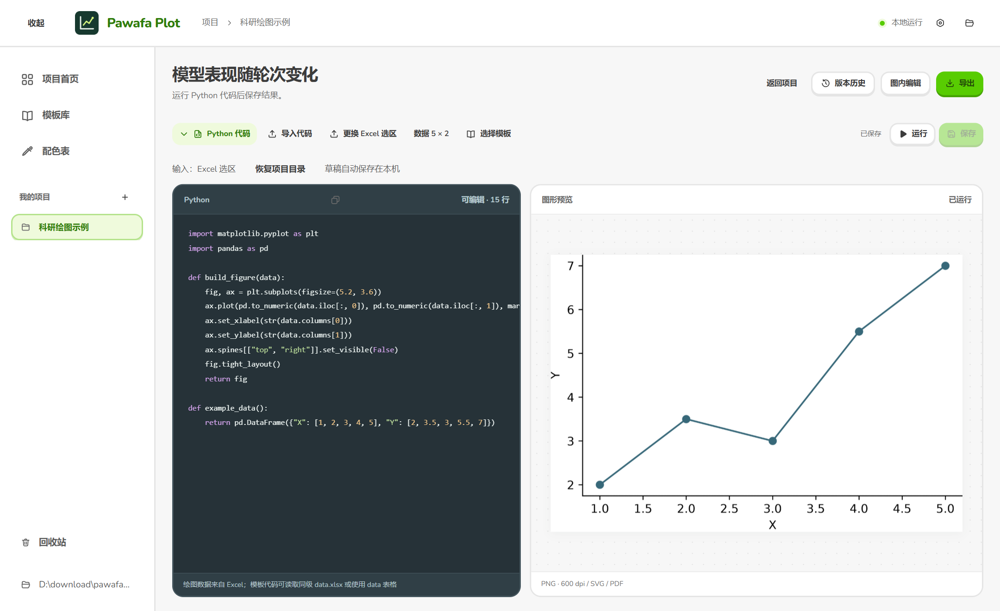
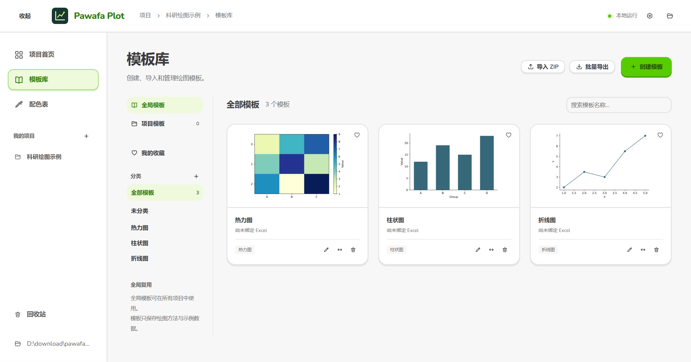

<p align="center">
  
</p>
<h1 align="center">Pawafa Plot</h1>
<p align="center"><strong>从 Excel 数据到可编辑的科研图</strong></p>
<p align="center">
  <a href="https://github.com/pawafa666-eng/plot-workbench/releases/latest"></a>
  <a href="LICENSE"></a>
</p>
<p align="center">
  <a href="https://github.com/pawafa666-eng/plot-workbench/releases/latest"><strong>下载 Windows 安装包</strong></a>
  · <a href="docs/workbench/usage.md">使用手册</a>
  · <a href="https://github.com/pawafa666-eng/plot-workbench-templates">在线模板库</a>
</p>

<br>



Pawafa 取自作者的网名「帕瓦发」。Pawafa Plot 是一个本地科研绘图工作台，可以从 Excel 选区、现成的 Matplotlib 脚本或绘图模板开始。运行结果可以保存到项目，也可以导出为 PNG（600 dpi）、SVG 或 PDF。上图和下方的模板库均为软件运行截图，使用合成示例数据。

## 从数据到图形

1. **新建项目**，选择本机的工作文件夹。项目中的图、代码和数据快照随项目保存。
2. **新建图**，导入 Excel 选区后挑选模板，或直接导入 Python 脚本。普通脚本默认从原脚本目录读取旁边的文件。
3. **运行并保存**，在预览中检查结果。点击 **图内编辑** 可调整图例、标注、颜色和坐标轴，完成后导出图形或可独立运行的代码和数据。

## 把绘图方法存成模板



点击 **模板库 → 创建模板**，在编辑页上传 Python 与 Excel，填写备注和数据要求，运行验证后保存。全局模板可以跨项目复用，项目模板保存在对应项目中。也可以从 [在线模板库](https://github.com/pawafa666-eng/plot-workbench-templates) 导入现成的模板。

**仿图绘制**可以用参考图生成 Python 代码、Excel 示例数据与行列要求。选择本机 Codex 可用的模型，检查结果后可调整、删除或应用到模板库。使用该功能需要已登录的 Codex CLI，参考图会发送给选中的模型。绘图和表格读取在本机完成。详见 [仿图绘制说明](docs/workbench/usage.md#仿图绘制)。

## 安装

从 [GitHub Releases](https://github.com/pawafa666-eng/plot-workbench/releases/latest) 下载 Windows x64 的 `Setup.exe`，安装后从开始菜单打开 **Pawafa Plot**。安装包已包含 Python、Matplotlib、pandas、seaborn、openpyxl 和 xlrd，可直接绘图和读取 Excel。早期 Plot Workbench 1.x 的用户可手动安装 v0.1，并在软件里重新打开原来的项目文件夹。

<details>
<summary>从源码构建 Windows 安装包</summary>

需要 Python、Node.js、pnpm、Rust 与 MSVC/Windows SDK。

```powershell
python -m venv .venv
.venv\Scripts\python -m pip install -e ".[worker,workbench]" pyinstaller
pnpm --dir web install --frozen-lockfile
.venv\Scripts\python scripts/workbench_build.py
```

安装包输出到 `dist/Pawafa-Plot-<version>-Windows-x64-Setup.exe`。签名和发布流程见 [更新与签名说明](docs/workbench/updating.md)。

</details>

## 来源与许可

Pawafa Plot 是 [Tavotto v0.18.0](https://github.com/Tavotto/Tavotto) 的授权衍生项目，基准提交为 `71c72fdb48f28411bd76a021e5d78d2005e76c8a`。感谢 erwanjun 和 Tavotto 贡献者。完整源码按 **AGPL-3.0-only** 发布，详见 [许可证](LICENSE) 和 [署名及第三方许可](docs/workbench/ATTRIBUTION.txt)。

Tavotto™ 是上游项目的未注册商标。参见 [商标政策](TRADEMARKS.md)、[法律说明](docs/legal/) 和 [贡献指南](CONTRIBUTING.md)。

<details>
<summary>上游 Tavotto 插件资料</summary>

### Using Tavotto with Codex for the first time

如需在 Codex 内安装上游 Tavotto 插件，请见 [Tavotto 的 Codex 安装指南](https://github.com/Tavotto/Tavotto#using-tavotto-with-codex-for-the-first-time)。

</details>
